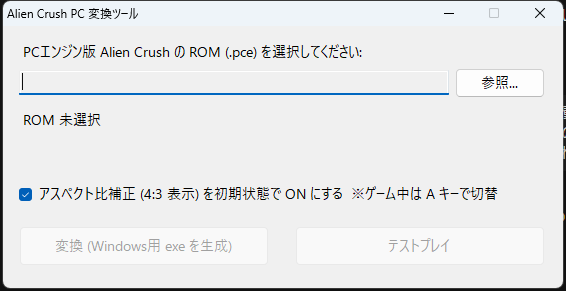
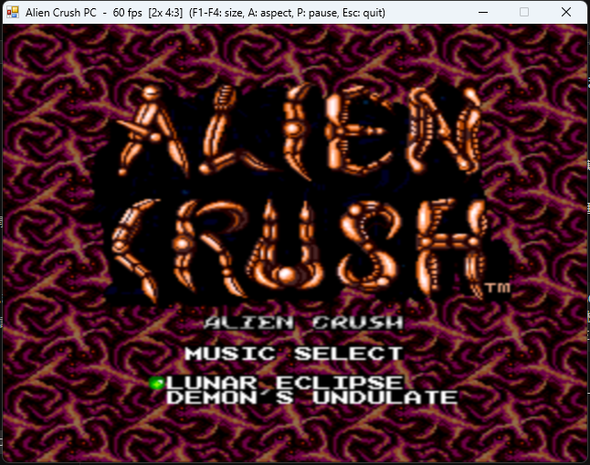
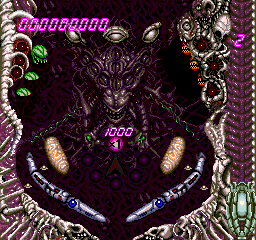
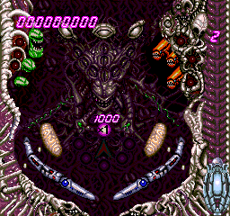
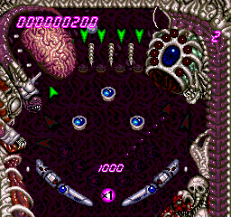
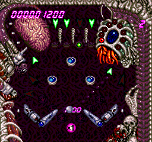

# PC エンジン ROM → Windows 変換ツール

PC エンジン / TurboGrafx-16 の HuCard ROM (.pce) を、Windows 11 上で単体動作する
実行ファイルに変換するツールです (最初の対象が『Alien Crush』だったため、ツール本体の名前は AlienCrushPC.exe のままです)。C# (.NET Framework 4.8 / WinForms) 製で、追加ランタイムの
インストールは不要です。

## ROM について (重要)

このリポジトリには **ROM (.pce) もそれを内蔵した exe も一切含まれていません**。
PC エンジン用ゲームの著作権は各権利者にあるため、ROM の配布・共有はしないでください。

- 使うには、ご自身が正当に所有している HuCard から吸い出した `.pce` を用意してください。
- 下表の ROM 名は「動作確認した対象」の記録であり、ROM データそのものではありません。
- 変換で生成した exe には ROM データが埋め込まれるため、その exe も公開・配布しないでください。

## 必要環境・ビルド

- Windows 10 / 11 (.NET Framework 4.8 が標準搭載されていれば追加インストールは不要)
- ビルドには Visual Studio Build Tools (C# コンパイラ `csc.exe` を含む) が必要です。
  `build.cmd` 冒頭の `CSC=` のパスは VS のバージョンによって異なるため、お使いの環境に合わせて書き換えてください。
  .NET SDK (`dotnet build`) は使いません。

```bat
build.cmd
```

成功すると `build\AlienCrushPC.exe` が生成されます。

## 動作確認済み ROM

| ROM | サイズ | 備考 |
|---|---|---|
| Alien Crush (USA) | 256KB | |
| Devil's Crush (USA) | 384KB | 256KB + 128KB の分割マッピング |
| Final Soldier (Japan) (En) / Special Version / Wii U VC 版 | 512KB | 全処理が割込内で動く (CLI の 1 命令遅延が必須) |
| Energy (Japan) | 256KB | |
| Dragon Spirit (USA) | 256KB | |
| Detana!! TwinBee (Japan) | 512KB | 表示幅 240 ドット |
| Darius Alpha (World) | 384KB | |
| Bonk 3 - Bonk's Big Adventure (USA, Europe) | 1MB | |
| Bravoman (USA) | 512KB | |
| Bikkuriman World (Japan) | 256KB | |
| Bari Bari Densetsu (Japan) | 384KB | |
| R-Type I / R-Type II (Japan) (En) | 256KB | 表示幅 352 ドット |
| Street Fighter II' - Champion Edition (Japan) | 2.5MB | 専用マッパー + 6 ボタンパッド (このゲームでのみ有効) |

いずれもヘッドレス実行でタイトル〜ゲームプレイ画面の描画と、ステートセーブの往復一致を確認しています。
上記以外の HuCard ROM も標準的な構成なら動く可能性がありますが、未確認です
(CD-ROM²、SuperGrafx、バックアップ RAM には非対応)。

## スクリーンショット

| 変換ツール | ゲーム画面 (2倍, 4:3 補正 ON) |
|---|---|
|  |  |

| タイトル | テーブル下半分 | テーブル上半分 | フリッパー操作中 |
|---|---|---|---|
|  |  |  |  |

(下段 4 枚はヘッドレスモードでエミュレータから直接書き出した 256x240 のドット等倍画像です)

## 構成

```
PCE_ROM/               元 ROM (.pce) を置くフォルダ ※リポジトリには含めていません (.gitignore 対象)
build/                 ビルド結果 (AlienCrushPC.exe と変換済み exe) ※ .gitignore 対象
build/games/           一括変換で生成した各ゲームの exe (ROM を内蔵するため配布しないこと)
build.cmd              ビルドスクリプト (Visual Studio Build Tools の Roslyn csc.exe を使用)
build/AlienCrushPC.exe 変換ツール本体 (ビルド後に生成)
src/Core/              HuC6280 CPU / HuC6270 VDC / HuC6260 VCE / PSG のエミュレーションコア
src/App/               WinForms GUI (変換画面・ゲーム画面)、waveOut 音声出力、XInput ゲームパッド
docs/analysis.md       ROM 解析レポート
tools/                 解析用 Python スクリプト (逆アセンブラ、RLE 展開)
```

## 使い方

1. `build.cmd` を実行して `build\AlienCrushPC.exe` を作る。
2. `AlienCrushPC.exe` を起動し、「参照...」で `.pce` を選ぶ（ドラッグ＆ドロップ可）。
   MD5 を照合して動作確認済みの ROM かどうかを表示します。
3. 「アスペクト比補正 (4:3 表示) を初期状態で ON にする」で起動時の表示モードを選びます
   (ゲーム中は A キーでいつでも切替可能)。
4. 「変換 (Windows用 exe を生成)」を押すと `<ROM 名>.exe` が生成されます。
   この exe は ROM と設定を内蔵しており、単体でゲームが起動します。
5. 「テストプレイ」で変換前に動作確認できます。
6. 「フォルダ内の ROM をまとめて変換...」で、フォルダ内の全 `.pce` を `Windows\<ROM 名>.exe` に一括変換できます。

コマンドラインでも変換できます:

```
AlienCrushPC.exe --pack "Alien Crush.pce" AlienCrush_Win.exe [--aspect]
```

`--aspect` を付けると 4:3 補正 ON で起動する exe になります。フォルダ単位の一括変換:

```
AlienCrushPC.exe --packall PCE_ROM build\games [--aspect]
```

## 操作

「ゲーム内の役割」は Alien Crush の例です (Final Soldier は Z=ショット / X=速度切替)。

| キー | PC エンジン | ゲーム内の役割 |
|---|---|---|
| 方向キー | 十字キー | 左フリッパー |
| X (または L) | I ボタン | 右フリッパー |
| Z (または K) | II ボタン | プランジャー (長押しで引き、離すと発射) |
| D | I ボタン連射 | 押している間 I を連打 (Street Fighter II' では V ボタン) |
| S | II ボタン連射 | 押している間 II を連打 (Street Fighter II' では IV ボタン) |
| T | – | 連射速度の切替 (秒間 30 / 20 / 15 / 10 連射、初期値 15) |
| Enter | RUN | スタート / ポーズ |
| Space (または Shift) | SELECT | セレクト |
| F1〜F4 | – | 表示倍率 1〜4 倍 |
| A | – | アスペクト比補正 (4:3 表示) の ON/OFF |
| F11 (または Alt+Enter) | – | フルスクリーン切替 |
| F5 / F7 | – | ステートセーブ / ロード |
| F6 | – | ステートスロット切替 (1〜5) |
| F9 | – | リセット |
| F12 | – | スクリーンショット (ドット等倍 PNG) |
| Tab (押している間) | – | 早送り (4 倍速、音声なし) |
| M | – | ミュート |
| P | – | 一時停止 (エミュレータ側) |
| H | – | 操作一覧を画面に表示 |
| Esc | – | 終了 (フルスクリーン中はウィンドウ表示に戻る) |

### 6 ボタンパッド (Street Fighter II' のみ)

| キー | パッド (XInput) | PC エンジン | 役割 |
|---|---|---|---|
| S / D / F | X / Y / RB | IV / V / VI | パンチ 弱 / 中 / 強 |
| C / Z / X | A / B / RT | III / II / I | キック 弱 / 中 / 強 |

### 2 人プレイ

2P は「2 台目のコントローラ」または「テンキー」で操作します (両方同時に有効)。

| 2P の操作 | PC エンジン |
|---|---|
| テンキー 8 / 4 / 6 / 2 (5 も下) | 十字キー |
| テンキー . | I ボタン |
| テンキー 0 | II ボタン |
| テンキー + / - | RUN / SELECT |
| 2 台目のコントローラ | 1 台目と同じ割り当て |
| F8 | 1 台目のコントローラを 2P に回す (1P はキーボード)。もう一度押すと元に戻る |

テンキーは NumLock ON で使います。コントローラ 1 台とキーボードで対戦する場合は F8 を押してください。

### ゲームパッド (XInput)

Xbox 互換コントローラを接続すると自動で使えます (1 台目 = 1P、2 台目 = 2P)。

| パッド | PC エンジン | ゲーム内の役割 |
|---|---|---|
| 十字キー / 左スティック | 十字キー | 左フリッパー |
| LB / LT | 左 | 左フリッパー |
| B / RB / RT | I ボタン | 右フリッパー |
| A | II ボタン | プランジャー |
| Y / X | I 連射 / II 連射 | – |
| START / BACK | RUN / SELECT | スタート / セレクト |

### ステートセーブ・スクリーンショットの保存先

どちらも exe と同じフォルダに保存されます。

- ステート: `<ゲーム名>.st1` 〜 `.st5` (スロットごとに 1 ファイル、約 74KB)
- スクリーンショット: `screenshots\<ゲーム名>_<日時>.png`

ゲーム名は、変換済み exe ではその exe のファイル名、テストプレイでは ROM のファイル名です。

ウィンドウが非アクティブになると自動で一時停止し、押していたキーは離された扱いになります
(戻ると自動で再開)。

## 仕組み

生成される exe は「変換ツール本体 + ROM データ + フラグ 4 バイト + フッタ 12 バイト (`ACRUSHv2` + ROM 長)」です。
起動時に自分自身の末尾を調べ、ROM が埋め込まれていればゲーム画面を直接開きます。
ゲーム画面では HuC6280 (7.16MHz)、VDC、VCE、PSG をソフトウェアで再現し、
262 ライン/フレームで実行、waveOut の再生クロックで 60fps に同期します。

## 開発者向け: ヘッドレス検証

```
AlienCrushPC.exe --headless "Alien Crush.pce" 1500 shot.png 8@400-410 8@600-610 8@800-810 2@1300-1400 --wav=out.wav
```

指定フレーム数だけ実行して PNG を保存します。`<入力マスク16進>@<開始>-<終了>` で入力を与えられます
(1=I 2=II 4=SELECT 8=RUN 10=UP 20=RIGHT 40=DOWN 80=LEFT、100〜800=III〜VI、1000/2000=I/II 連射、先頭に `p2:` を付けると 2P の入力)。`--trace=N` でフレーム N の実行アドレス一覧、
`--wav=` で音声を書き出します。結果は `headless.log` / `ram.bin` / `vram.bin` に出ます。
`--stateroundtrip=N` を付けるとフレーム N でステートを保存し、新しいマシンに読み込んで続行します
(付けない場合と PNG / WAV / ram.bin が完全一致すればステートセーブは正常)。

## エミュレーションの対応範囲

- ROM: 8KB 単位のミラー、384KB (256+128KB) / 512KB カードのバンク配置、512 バイトヘッダ付き・ビット反転ダンプの自動補正
- HuC6280: 全命令 (ブロック転送、T フラグ、BCD 演算を含む)、タイマ割込、高速/低速クロック切替、CLI/SEI/PLP の割込受付 1 命令遅延
- ROM (続き): Street Fighter II' の 2.5MB マッパー ($1FF0-$1FF3 への書き込みで上位 512KB を切替)
- パッド: マルチタップのポート走査 (1P・2P を接続、3P 以降は未接続)、2 ボタン / 6 ボタン
- VDC: BG (32〜128 x 32〜64 タイル)、スプライト (16/32 x 16/32/64、反転、優先度)、ラスタ割込 (RCR)、
  VRAM-VRAM DMA、SATB DMA、スプライト 0 衝突フラグ、1 ライン 16 スプライト制限と溢れフラグ
- VCE: 512 色パレット、ドットクロックによる表示幅 (256/352/512)
- PSG: 6 チャンネル波形メモリ音源、DDA、ノイズ (ch5/6)、LFO (ch2 の波形で ch1 を周波数変調)。
  CPU 命令単位のタイミングで 4 倍オーバーサンプリング合成し、出力の DC 成分を除去
- 表示: ドット等倍、または 4:3 アスペクト比補正 (横方向のみ線形補間、縦はドットのまま) を A キーで切替。
  拡大は自前のスケーラで行い、GDI+ の補間拡大より CPU 負荷を大きく下げています (3 倍・4:3 表示で 1 コアの約 96% → 約 38%)

## 既知の制限

- ステートセーブの形式を変更したため、以前のバージョンで保存した `.st*` は読み込めません。

- 1 ライン 16 スプライト制限は実機同様に描画を打ち切るため、スプライトが多い場面では実機と同じくちらつきます。
- 実機の NTSC 59.94Hz ではなく、音声出力 (44.1kHz) を基準に 60Hz で同期しています。

## 注意事項

- 本ソフトは個人的な検証・学習目的のエミュレータ / 変換ツールです。動作保証はありません。
- ROM の入手方法 (吸い出し・配布) について、このリポジトリでは案内・提供を行いません。
- 不具合報告や改善案は Issue / Pull Request でお願いします。
